# Wireshark Basics Lab

A hands-on lab that covers three things:

1. Setting up Wireshark in a virtual machine
2. Comparing HTTP and HTTPS traffic
3. Doing a basic malware traffic analysis on a real PCAP file

## Lab Environment

- Hypervisor: VMware
- Guest OS: Windows 11 Pro, customized with Tiny11 (no Copilot, Outlook, or Edge)
- Browser: Brave
- Packet analyzer: Wireshark with Npcap

To build the same ISO, download Tiny11 and apply it to a Windows 11 Pro ISO.

## Part 1: Setup

### Install Brave

1. Open PowerShell as administrator.
2. Run this command:

```
winget install brave.brave
```

3. Press `y` when it asks for confirmation.

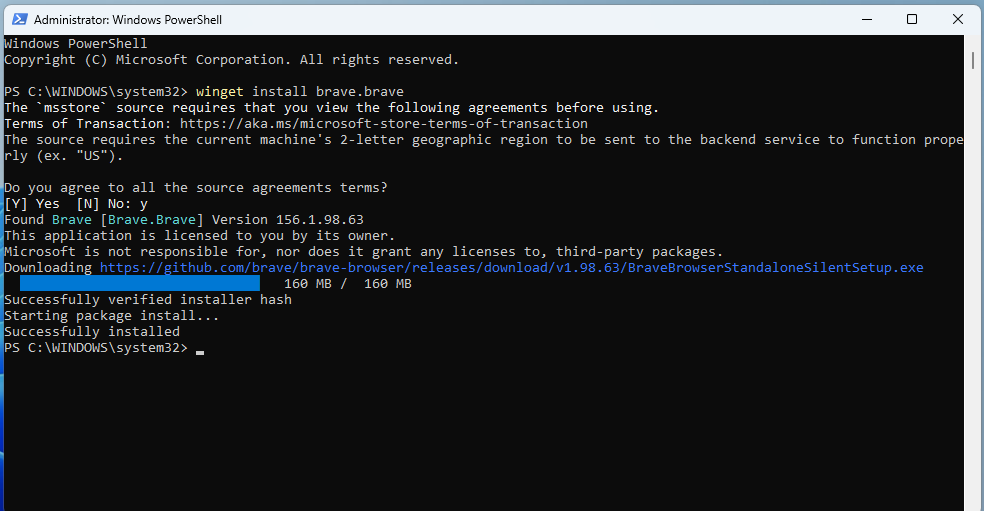

### Install Wireshark

Pick one method.

Method 1: Download the installer from https://www.wireshark.org/download.html and run it.

Method 2: Use PowerShell (the method used in this lab):

```
winget install Wireshark
```

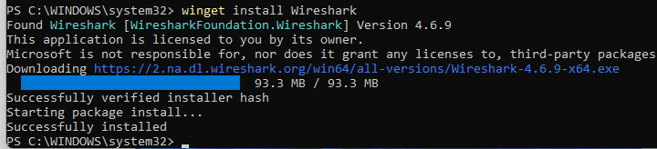

### Install Npcap

Wireshark asks you to install Npcap on first launch.

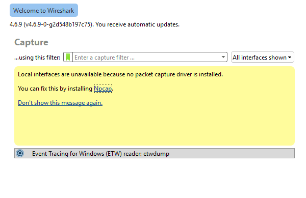

1. Click the blue Npcap link in the message.
2. Download the latest version and install it.
3. Close Wireshark and open it again.
4. You now see all network interfaces.

## Part 2: HTTP vs HTTPS

### Capture HTTP traffic

1. Open Brave next to Wireshark.
2. Double-click `Ethernet0` in Wireshark to start the capture.
3. Open `http://httpforever.com` in Brave.
4. Browse the site for a short time.
5. Click the red stop button at the top to end the capture.

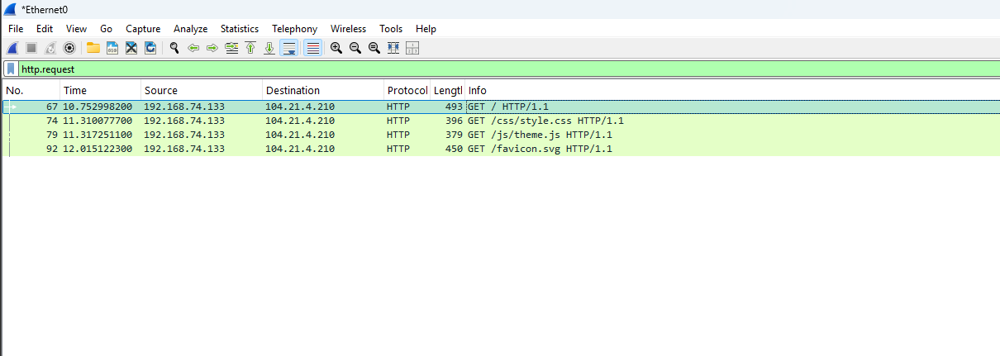

### Inspect the HTTP request

1. In the display filter bar, type `http.request` and press Enter.
2. Double-click the first packet.
3. Check the source IP and destination IP at the top.
4. Expand **Hypertext Transfer Protocol**.

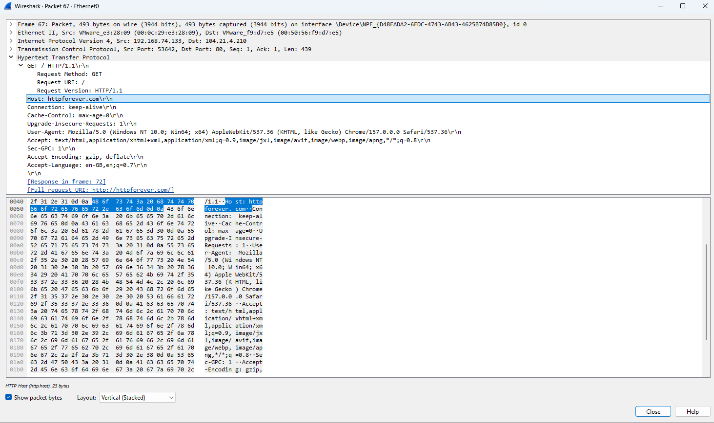

What you see:

- The site address
- The headers
- The content itself
- Port 80
- No encryption

HTTP sends everything in plain text. Anyone who captures packets on your network reads the site name and the data you send and receive.

### Capture HTTPS traffic

1. Close Wireshark and open it again.
2. Start a new capture.
3. Open `https://example.com` in Brave.
4. Stop the capture after enough packets arrive.

### Inspect the TLS handshake

1. Type `tls` in the display filter and press Enter.
2. Select the third packet, labeled **Client Hello**.
3. Double-click it and expand **Transport Layer Security**.
4. Expand **TLSv1.3 Record Layer**, then **Handshake Protocol**.
5. Scroll down to **Extension: server_name** and expand it.

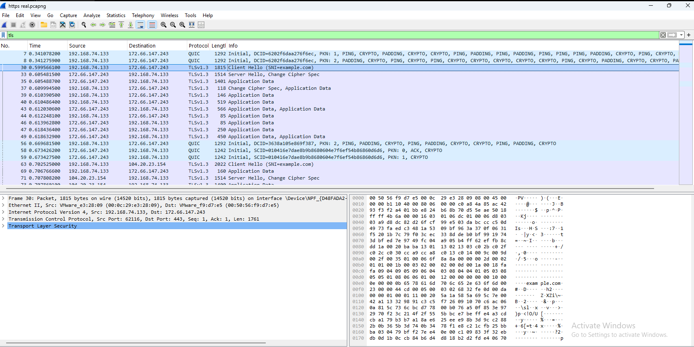

You see the website name `example.com`. Everything else is encrypted and shows as random hexadecimal bytes.

### Why the website name is visible

The connection starts in the open. Your computer tells the server which website it wants so the server sends back the right SSL/TLS certificate. This field is called the Server Name Indication (SNI).

### What this means for privacy

- Your ISP sees the domain of every site you visit, even in incognito mode.
- Your ISP does not see the pages, URLs, paths, or content on an HTTPS site.

## Part 3: Basic Malware Traffic Analysis

### Get the sample

Source: https://malware-traffic-analysis.net

Sample used: https://malware-traffic-analysis.net/2026/02/28/index.html

1. Download the zip file.
2. The password follows the pattern `infected_<YYYYMMDD>`. For this sample it is `infected_20260228`.
3. Unzip the file and open the folder.
4. Double-click the PCAP file to open it in Wireshark.

Warning: Open malware samples only inside a virtual machine, never on your main system.

### Questions to answer

1. What is the IP address of the infected Windows client?
2. What is the MAC address of the infected Windows client?
3. What is the host name of the infected Windows client?
4. What is the user account name on the infected Windows client?
5. What is the full name of the user behind that account?

The PCAP holds about 15,512 packets. Use filters and statistics to narrow it down.

### Question 1: IP address

1. Go to **Statistics > Conversations**.
2. Open the **IPv4** tab.
3. Click the **Packets** column header twice to sort from high to low.
4. The top conversation is between `10.2.28.88` and `10.2.28.2`.

The host with the most traffic is usually the infected one.

Answer: `10.2.28.88`

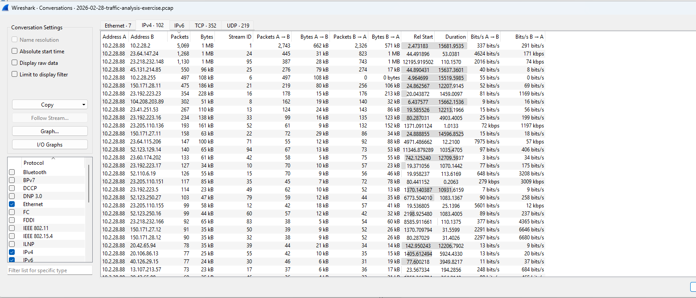

### Question 2: MAC address

1. Close the Conversations window.
2. Apply this filter:

```
ip.addr == 10.2.28.88
```

3. Double-click the first packet where the source is the infected IP.
4. Expand **Ethernet II**.

Answer: `00:19:d1:b2:4d:ad`

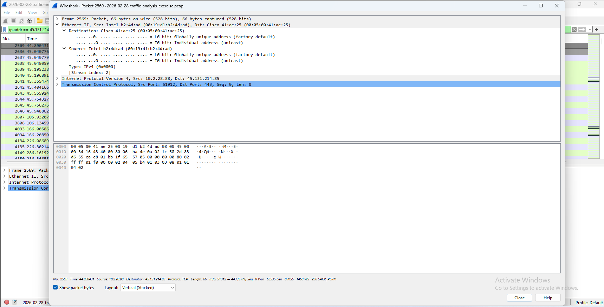

### Question 3: Host name

1. Apply this filter:

```
nbns
```

NBNS stands for NetBIOS Name Service.

2. Double-click the first packet.
3. Expand **NetBIOS Name Service**, then **Queries**.

Answer: `DESKTOP-TEYQ2NR`

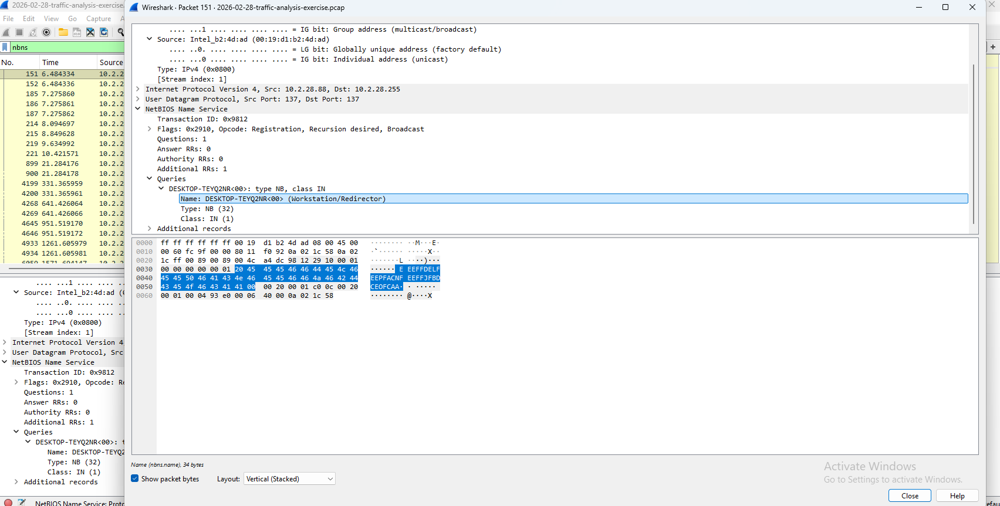

### Question 4: User account name

1. Apply this filter:

```
kerberos
```

2. In the Info column, select the first **AS-REQ** packet.
3. Expand **Kerberos > as-req > req-body > cname > cname-string**.

Answer: `brolf` (first initial `b` and last name `rolf`)

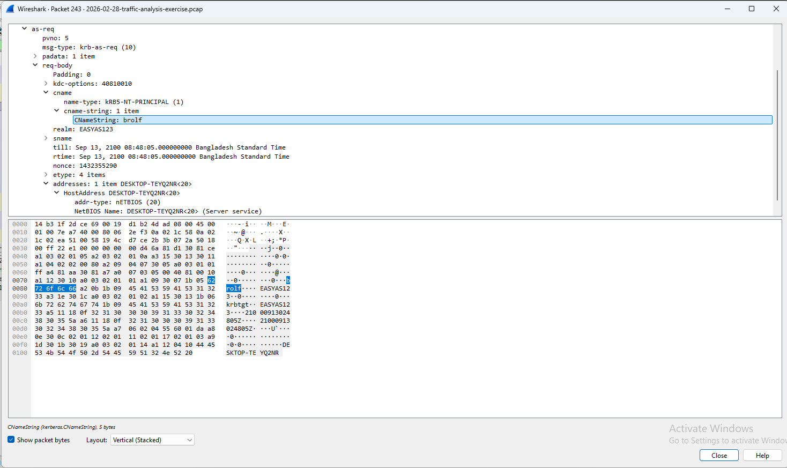

### Question 5: Full name

1. Apply this filter:

```
samr
```

2. Press `Ctrl + F` or go to **Edit > Find Packet**.
3. Search for the user info response, as shown below.
4. Watch the Info column and look for **QueryUserInfo response**.
5. Expand **SAMR > Pointer to info > samr_UserInfo > Info21**.

Answer: `Becka Rolf`

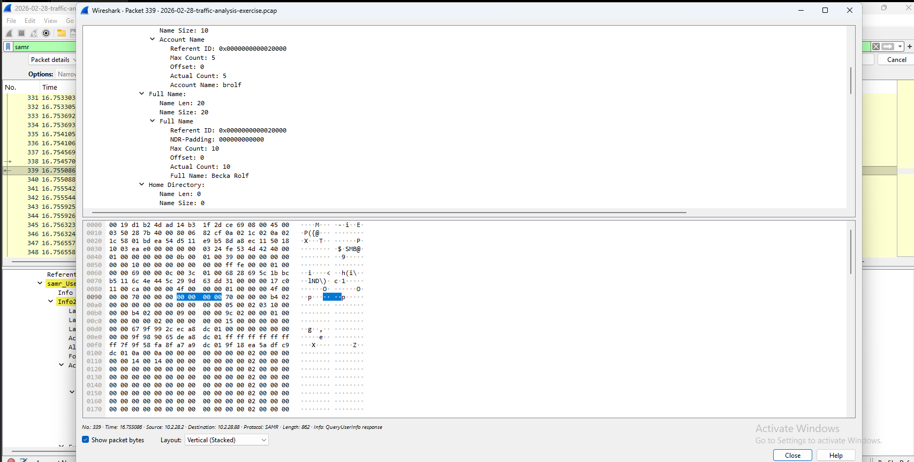

## Findings Summary

| Question | Answer |
| --- | --- |
| IP address | 10.2.28.88 |
| MAC address | 00:19:d1:b2:4d:ad |
| Host name | DESKTOP-TEYQ2NR |
| User account name | brolf |
| Full name | Becka Rolf |

## Wireshark Filters Used

| Filter | Purpose |
| --- | --- |
| `http.request` | Show HTTP requests |
| `tls` | Show TLS traffic |
| `ip.addr == <IP>` | Show traffic to or from one IP |
| `nbns` | Show NetBIOS name queries |
| `kerberos` | Show Kerberos authentication traffic |
| `samr` | Show Security Account Manager traffic |

## Key Takeaways

- HTTP exposes everything on the wire. HTTPS hides content but not the domain name.
- The host with the most conversation traffic is a good first lead for the infected machine.
- NBNS gives you the host name.
- Kerberos AS-REQ packets give you the account name.
- SAMR responses give you the full user name.

## Folder Structure

```
.
├── README.md
└── images/
    ├── 01-brave-install.png
    ├── 02-wireshark-install.png
    └── ...
```

## Credits

- Malware traffic samples: https://malware-traffic-analysis.net
- Tiny11 for the customized Windows ISO
